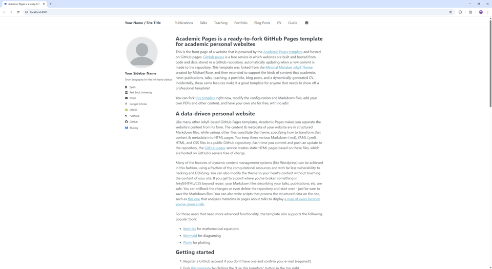

# Academic Pages
**Academic Pages is a GitHub Pages template for personal and professional portfolio-oriented websites.**



# Getting Started

1. Register a GitHub account if you don't have one and confirm your e-mail (required!)
1. Click the "Use this template" button in the top right.
1. On the "New repository" page, enter your public repository name as "[your GitHub username].github.io", which will also be your website's URL.
1. Edit site-wide configuration in `_config.yml` and double check that the `url` is the one that you just selected in the previous step and that `repository` reflects the correct path for your repository.
1. Add your site content, upload any files (like PDFs, .zip files, etc.) to the `files/` directory. They will appear at https://[your GitHub username].github.io/files/example.pdf.
1. Check status by going to the repository settings, in the "GitHub pages" section
1. (Optional) Use the Jupyter notebooks or python scripts in the `markdown_generator` folder to generate markdown files for publications and talks from a TSV file.

See more info at https://academicpages.github.io/

### Additional Tutorials

Additional tutorials for working with the Academic Pages template can be found at the following sites:
- https://jayrobwilliams.com/posts/2020/06/academic-website/

## Running locally

When you are initially working on your website, it is very useful to be able to preview the changes locally before pushing them to GitHub. It can take a while for GitHub to update your page, and you might find mistakes before you commit them. If you want to save work that you haven't finished and don't want to publish directly, you can commit it to a development branch and then once you've finished, merge it back into the main branch. To work locally we will use a Docker container to render and serve the website locally without dealing with all the dependency issues (this repo's Jekyll/Ruby dependencies are pinned to older versions to match GitHub Pages' production build, and are often incompatible with a very recent Ruby installed directly on your machine, especially on Windows):

1. Clone the repository and make updates as detailed above.
1. Install [Docker](https://www.docker.com/) (Docker Desktop on Mac/Windows).
1. Build and start the container by running the following command in the repository:

```bash
chmod -R 777 .
docker compose up --build
```

   The first run will take a minute or two while it builds the image and installs gems; subsequent runs reuse the image and start in seconds. Leave this running in its terminal — it will keep printing rebuild logs as you edit files.

1. Once you see `Server running...` in the terminal, access the website from `localhost:4000`.
1. Edit files in the repository as usual. The container should rebuild automatically after a few seconds — just refresh the page in your browser.
1. When you're done, stop the container with `Ctrl+C`, or `docker compose down` if you started it detached (`docker compose up -d --build`).

**Troubleshooting:** 
1. If the container fails to start with a `Bundler::GemNotFound` error, you likely have a stale `Gemfile.lock` left over from previously trying to run Jekyll outside of Docker on this machine. Delete it (`rm Gemfile.lock`) and run `docker compose up --build` again — Docker will regenerate a lockfile that matches the versions installed inside the container.
2. If you are using Docker Desktop on Mac/Windows and the locally hosted website does not update when you make changes, you can force Docker to watch for any changes by altering `docker-compose.yaml`'s `command:` line to `command: jekyll serve -H 0.0.0.0 -w --force_polling --config _config.yml,_config_docker.yml`. Make sure to keep the formatting consistent.

## Remember to commit your changes to your repository on GitHub so that they propogate to the public version of your website!

# Maintenance

Bug reports and feature requests to the template should be [submitted via GitHub](https://github.com/academicpages/academicpages.github.io/issues/new/choose). For questions concerning how to style the template, please feel free to start a [new discussion on GitHub](https://github.com/academicpages/academicpages.github.io/discussions).

This repository was forked (then detached) by [Stuart Geiger](https://github.com/staeiou) from the [Minimal Mistakes Jekyll Theme](https://mmistakes.github.io/minimal-mistakes/), which is © 2016 Michael Rose and released under the MIT License (see LICENSE.md). It is currently being maintained by [Robert Zupko](https://github.com/rjzupkoii), and additional maintainers would be welcome.

## Bugfixes and enhancements

If you have bugfixes and enhancements that you would like to submit as a pull request, you will need to [fork](https://docs.github.com/en/pull-requests/collaborating-with-pull-requests/working-with-forks/fork-a-repo) this repository as opposed to using it as a template. This will also allow you to [synchronize your copy](https://docs.github.com/en/pull-requests/collaborating-with-pull-requests/working-with-forks/syncing-a-fork) of the template to your fork as well.

Unfortunately, one logistical issue with a template theme like Academic Pages that makes it a little tricky to get bug fixes and updates to the core theme. If you use this template and customize it, you will probably get merge conflicts if you attempt to synchronize, although [rebasing](https://git-scm.com/docs/git-rebase) the changes from this template will work along with manually [cherry picking](https://git-scm.com/docs/git-cherry-pick) the relevant commits. If you are not comfortable with the Git command line, you can save your various `.yml` configuration files and Markdown files, delete the repository, and fork it again. 

---
<div align="center">
    

[](https://github.com/academicpages/academicpages.github.io/graphs/contributors)
[](https://github.com/academicpages/academicpages.github.io/releases/latest)
[](https://github.com/academicpages/academicpages.github.io/blob/master/LICENSE)

[](https://github.com/academicpages/academicpages.github.io)
[](https://github.com/academicpages/academicpages.github.io/fork)
</div>
